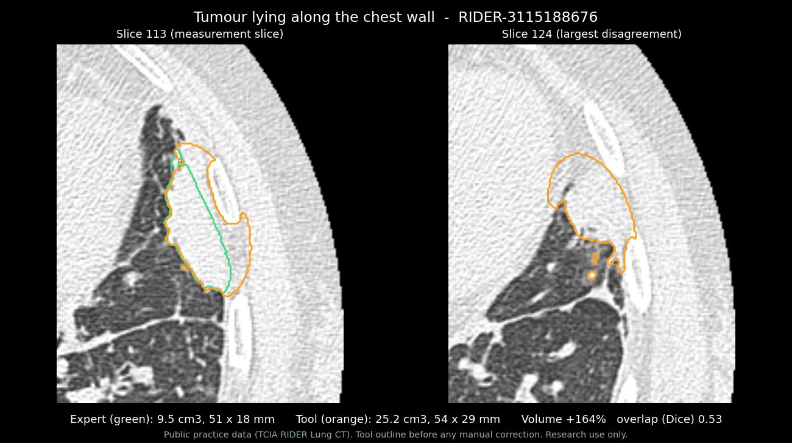
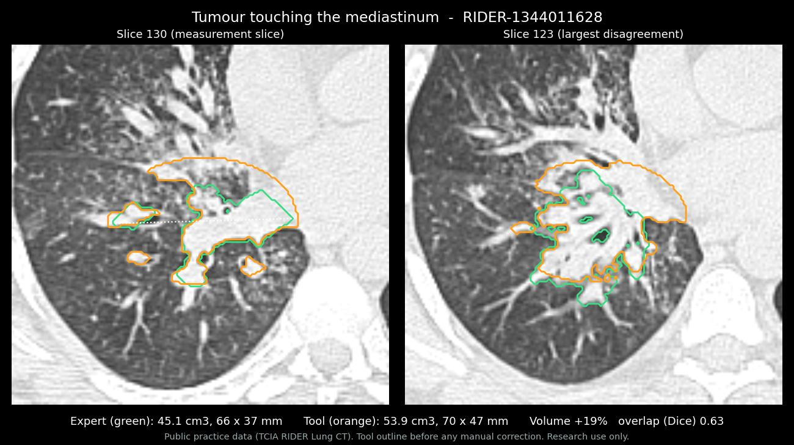
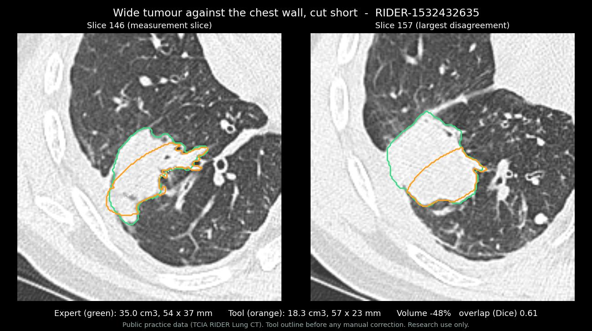
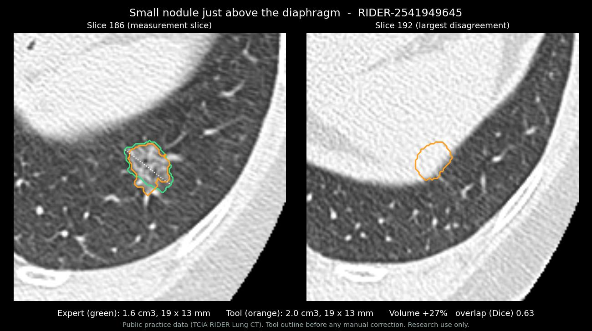
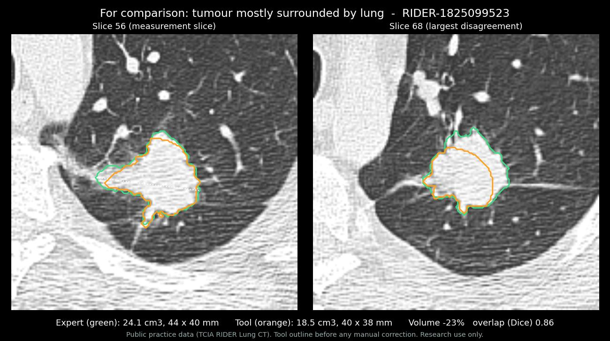

# Where the outline goes wrong

Daniel and Naomi both asked to see the cases the tool gets wrong, especially near the chest wall.
These are the worst cases from the development scans (10 patients, 19 scans), plus one ordinary case
for comparison. The 21 test patients have not been looked at yet and are not shown here.

In every picture: **green** is the expert's manual outline from the public dataset, **orange** is the
tool's outline before any correction, and the dotted line is the stroke the tool was given (the expert's
own long axis, so the stroke is as good as it can be). Left is the slice the measurement is taken on;
right is the slice where the two outlines differ most.

Images: TCIA RIDER Lung CT with the RIDER-LungCT-Seg outlines, public and de-identified. Research use only.

Regenerate with `node app/scripts/dump_outlines.ts <cases>` and `python eval/failure_gallery.py`.

| Case | What happens | Volume vs expert | Overlap (Dice) |
|---|---|---|---|
| RIDER-3115188676 | Leaks into the chest wall | +164% | 0.53 |
| RIDER-1344011628 | Leaks into the mediastinum, picks up vessels | +19% | 0.63 |
| RIDER-1532432635 | Cuts a wide tumour short | −48% | 0.61 |
| RIDER-2541949645 | Leaks down into the diaphragm | +27% | 0.63 |
| RIDER-1825099523 (ordinary case) | Follows the edge, loses the top and bottom | −23% | 0.86 |

For scale: two expert outlines of the same tumour on the same day differ by 6.8% in volume (median),
and by up to 37%.

## 1. Tumour lying along the chest wall

The tumour is a flat plate against the chest wall. Tumour and chest-wall muscle have the same density on
CT, so a rule based on brightness has no edge to stop at: the outline runs out through the muscle to the
rib, and eleven slices away it is drawing chest wall where the expert drew nothing.
The long axis is still close (54 vs 51 mm), because it runs along the lung side, but the short axis and
the volume are not usable. This is the worst case in the development set and the one the tool should not
be trusted on without the reader redrawing the wall side.

## 2. Tumour touching the mediastinum

Same cause on the other side: where the tumour meets the hilum and mediastinum there is no density edge,
and the outline spreads into them. It also picks up separate vessels near the stroke as small islands.
The volume error (+19%) looks moderate only because the leak and the missed spiculated edges partly
cancel; the short axis is off by 10 mm.

## 3. Wide tumour, cut short

The opposite error. To stop leaks, the tool only looks inside a rounded region around the stroke, and it
sets the width of that region from how far the tumour extends on the lung side. This tumour is as wide as
it is long and sits against the chest wall, so the region comes out too narrow and half of the tumour is
left outside it. The straight diagonal edge in the right-hand picture is the limit of that region, not
anything in the image.

## 4. Small nodule just above the diaphragm

On the measurement slice the outline is reasonable, and the two diameters match the expert's
(19 x 13 mm). Six slices away, the outline has spread into the dome of the diaphragm, which adds
volume that is not tumour. This is one of the smallest tumours in the development set (1.6 cm3) and a faint one,
so the brightness cut-off the tool picks is low (−675 HU), which makes leaks easier.

## 5. For comparison: an ordinary case

With lung around most of the tumour the outline follows the edge closely on the measurement slice. Twelve
slices away it is still too tight at the top, so the volume comes out 23% low. That is typical: across
the development scans the median difference from the expert is about 16% in volume before correction.

## What these have in common

1. **No density edge, no outline.** Wherever tumour touches chest wall, mediastinum or diaphragm, the
   tool either leaks (cases 1, 2, 4) or is held back by its own safety region (case 3). A stroke plus
   brightness cannot tell tumour from muscle. This is the main reason an image model is being compared
   next: the cases above are the test for it.
2. **Errors grow away from the stroke.** The measurement slice is usually better than the slices above
   and below it, so diameters are more reliable than volume.
3. **None of these is silent in the picture, but none is flagged either.** The reader sees the leak, and
   Add / Erase fix it, yet the tool does not currently warn that an outline touches the chest wall.

## Not shown yet

- A follow-up scan where the carried-over outline is badly wrong (2 of 9 development pairs, −85% and −50%).
- Small or ground-glass nodules: the practice data has none (smallest tumour here is 13 mm).
